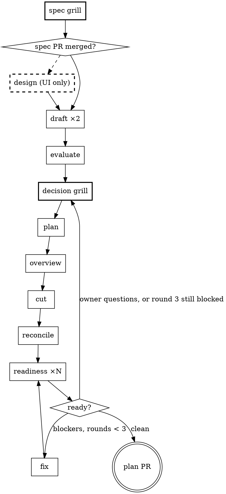

# Feature plan

You plan one feature for `/feature-loop`. The output is exactly what the loop reads:
`00-overview.md`, `DECISIONS.md` and one file per task, with anchors that survive earlier
tasks landing. Planning takes two sessions, one up to the spec PR and one from its merge to
the plan PR. `plan-log.md` is where a session picks up.

Arguments: `$ARGUMENTS`, the feature's name. It is both the directory under `docs/tasks/`
and the feature branch, and starts `issue-<n>-`. If it does not, ask for the issue number.

Read `${CLAUDE_PLUGIN_ROOT}/loop/feature-plan/plan-format.md` now. It defines every file, header and id
this skill and its agents use. Every path is relative to the repository root.

## What a session does

A session routes on the log's last row and keeps going, through owner steps (spec grill,
design, decision grill) and agent steps alike, until it needs a merge only the owner can
give: the spec PR or the plan PR. There it stops (see "Stopping"). The owner answers inside
the session, in the grills, and never has to start one to move a step along.

A subagent cannot ask the owner anything, so there is no griller agent: you run the grills.



Bold boxes are steps you run with the owner. Everything else is an agent you dispatch.

## Branches and worktrees

    master
     └─ <feature>              draft PR into master, opened by the first run
         ├─ <feature>-spec     spec grill and spec, PR into <feature>
         └─ <feature>-plan     cut from <feature> after the spec PR merges, PR into <feature>
         └─ <feature>-task-NN  /feature-loop

Each phase branch has its own worktree, `.claude/worktrees/<feature>-spec` and
`.claude/worktrees/<feature>-plan`, created by the session that starts the branch. Never
switch branches inside a worktree another session may have open (G8). Planning needs no
`.env` and no `node_modules`.

Every session pushes its branch before it ends.

## Setup, once per session

1. **Attribution.** Your instructions give commit and pull request attribution lines. Store
   them, verbatim, before anything else:

       python3 ${CLAUDE_PLUGIN_ROOT}/loop/_lib/loop.py set-attribution --commit '<commit lines>' --pr '<pull request lines>'

   Every commit you make goes through `loop.py commit '<subject>' <path>…`, which stages those
   paths and adds the commit lines, in every worktree of the repository. PR bodies end with
   the PR lines.

   **One plain command per Bash call,** each command in this file as written, under the rules
   of "Commands" in `${CLAUDE_PLUGIN_ROOT}/loop/feature-loop/handoff-format.md`.
2. **Find the log.** From the main checkout, `git fetch origin`, then take the first of these
   branches that exists locally or on origin: `<feature>-plan`, `<feature>-spec`, `<feature>`.
   Read its log without checking it out:
   `git show <branch>:docs/tasks/<feature>/plan-log.md` (prefer the local branch when it is
   ahead of origin).
   - No branch exists: go to "Start".
   - `<feature>` exists and nothing else: the first run was cut off after its first commit. Go
     to "Start", step 3.
3. **Enter the worktree** for that branch, `.claude/worktrees/<branch>`. If it does not exist,
   `git worktree add .claude/worktrees/<branch> <branch>` (tracking origin if the branch is
   only there). Switch in with EnterWorktree and its `path`. If the worktree has uncommitted
   changes, see "Resuming".
4. **Route** on the last row, with "Routing".

## Start

1. `gh issue view <n>` must find the issue. If not, ask for it.
2. **Feature branch.** `git worktree add -b <feature> .claude/worktrees/<feature>-spec
   origin/master`, and enter it. Write `docs/tasks/<feature>/plan-log.md` from the template in
   plan-format.md with row 0, commit it as `docs(<feature>): plan row 0`, `git push -u origin
   <feature>`, and open the draft PR, labelled `feature-branch`:
   `gh label create feature-branch --color 1D76DB --description "Feature branch PR into master"
   --force`, then `gh pr create --draft --base master --head <feature> --title "<type>(<scope>):
   <issue title, lower case> (#<n>)" --label feature-branch --body "Feature branch for #<n>.
   Planned with /feature-plan, built with /feature-loop."`. Take type and scope from `git log
   --oneline -8` on master.
3. **Spec branch.** In the same worktree, `git checkout -b <feature>-spec`. No other session
   can have this worktree open yet, so this one switch is safe. Put the draft PR's number in
   the log's `Feature branch:` line. It is committed with the spec grill's `started` row.
4. Run the spec grill.

## Routing

On the last row of `plan-log.md` whose `#` is a whole number, skipping a parallel step's
sub-rows:

| Last row | Next |
|---|---|
| none, or `start` | spec grill |
| `spec grill`, `started` | spec grill, resumed from its frontier |
| `spec grill`, `done` | open the spec PR (spec grill, step 6) |
| `spec`, `spec PR #n` | the spec gate |
| `gate`, UI yes in the spec, no `design done` row | design |
| `design`, `started` | design, resumed |
| `gate` with UI no, or `design`, `done` | draft |
| `draft` | evaluate |
| `evaluate` | decision grill |
| `decision grill`, `started` | decision grill, resumed |
| `decision grill`, `done`, no earlier `plan` row | plan |
| `decision grill`, `done`, after a `readiness: owner questions` row | apply the decisions |
| `plan` | overview |
| `overview` | cut |
| `cut` | reconcile |
| `reconcile`, `fix <r>`, `decisions applied` or `feedback applied` | readiness, next round |
| `feedback` | apply the feedback |
| `readiness <r>`, every task READY, and a `plan PR` row exists | update the plan PR |
| `readiness <r>`, every task READY | plan PR |
| `readiness <r>`, any Owner above 0 | log `readiness: owner questions` |
| `readiness <r>`, Blocking above 0, round 3 since the last decision grill or cut | log `readiness: owner questions` |
| `readiness <r>`, a Repeat id already repeated in an earlier round | log `readiness: owner questions` |
| `readiness <r>`, Blocking above 0 | fix |
| `readiness: owner questions` | decision grill |
| `plan PR #n`, or `plan PR updated` | the plan gate |
| `stopped` | tell the owner what the row says, and wait |

## The spec grill

A session with the owner. Load the `eliot:grilling` skill and follow it, with "Grilling rules" below on top.

1. Log `spec grill | session | started | grill/spec.md` unless the last row already is that,
   and commit.
2. Read the issue (`gh issue view <n> --comments`) and the code it names. Read
   `grill/spec.md` if it exists and start from its last `Frontier:` line.
3. Grill. The tree covers what the feature does, what it does not do, how it behaves at each
   edge, and **whether it has UI**.
4. When the owner confirms the frontier is empty, write `docs/designs/<feature>.md` as
   plan-format.md's "The spec" says, with `Status: IN REVIEW` and every settled answer as a
   T row.
5. Log `spec grill | session | done, <rounds> rounds, <n> T rows, UI <yes|no>`, committing the
   spec and grill file with it.
6. Push, then `gh pr create --base <feature> --head <feature>-spec --title "docs(designs):
   <title> spec (#<n>)" --body-file <a file you write: the Summary, the T count, UI yes or no,
   and the attribution lines>`. Always pass `--base`. Log `spec | session | spec PR #<n>`,
   commit, push.
7. Stop. Tell the owner the PR URL, that merging it approves the spec, and end with the
   command.

## The spec gate

`gh pr view <n> --json state -q .state` on the spec PR from the log.

- **Not merged.** Tell the owner it is waiting on them. If they ask for changes, they are a
  reopened spec grill: run it in this session (step 2 onwards), push, and the PR updates
  itself. Otherwise stop.
- **Merged.** `git fetch origin`, then from the main checkout
  `git worktree add -b <feature>-plan .claude/worktrees/<feature>-plan origin/<feature>` and
  enter it. In the spec, set `Status: APPROVED`. Log `gate | router | spec PR #<n> merged,
  plan branch cut`, commit both, push with `-u`. Route again.

## The design phase

A session with the owner, only when the spec says `UI: yes` (G9). It runs before the drafts,
so the plan is drawn from the design rather than patched by it.

1. Log `design | session | started` and commit.
2. Load `frontend-design`. Read the spec, `CLAUDE.md`'s "How it looks", and the components the
   spec names.
3. Write three to six mockups that disagree with each other, each a self-contained HTML file
   in `docs/designs/<feature>-mockups/<NN>-<name>.html` with a `<NN>-<name>.md` beside it: the
   idea in one line, what it gives up. Mock only with styles the app already uses,
   so a mockup can become code.
4. Show them to the owner (publish one private Artifact page with every mockup, or have them
   open the files) and grill the choice with `/grilling`, keeping state in
   `grill/design.md` in the grill file format.
5. Write `docs/designs/<feature>-visual.md` in the layout of
   `docs/designs/embed-timeline-visual.md`: who chose what and when, the reference mockup, the
   idea, layout, then each surface. A choice that changes behaviour revises its T row in the
   spec, as plan-format.md says, and the visual spec lists those rows.
6. Log `design | session | done, <n> mockups, chose <NN>`, committing everything. Push. Route
   again.

## The decision grill

A session with the owner. Load the `eliot:grilling` skill and follow it, with "Grilling rules" below on top.

1. Log `decision grill | session | started` and commit.
2. **First run.** Read `EVALUATION.md`: its verdict, its amendments, its questions. The first
   frontier is the verdict, each E (adopt, change, reject) and each Q.
   **Reopened** (last row before this was `readiness: owner questions`). Collect every open or
   reopened finding with `Owner: human`, and after a third blocked round every open or
   reopened finding at all:
   `grep -B2 -A4 -E '^Owner: human$' docs/tasks/<feature>/readiness/*.md`. Start a
   `## Reopened <k>` section in `grill/decisions.md` whose first frontier is those findings.
   **Resumed** (last row is `started`). Start from the last `Frontier:` line.
3. Grill. Check every claim against the code as it is given.
4. When the owner confirms the frontier is empty, write `DECISIONS.md` as plan-format.md
   says: D ids for owner decisions, E ids for adopted amendments. A reopened grill appends
   and never renumbers. Revise the spec where a decision changes a T row.
5. **Reopened only.** On each finding the grill settled, set `Owner: cutter` and write
   `Ruling: Human: <the D id and one sentence>`, leaving the status as it is.
6. Log `decision grill | session | done, <n> D, <n> E adopted, <n> T revised`, committing
   every file with it. Push. Route again.

## Grilling rules

On top of `/grilling`, in every grill:

- **Check every answer against the code as it is given.** Open the lines the answer relies
  on. If the code says otherwise, say so in the next round. A fact you can look up is never
  a question.
- **The grill file is the state (G13).** Before asking a round, append its `### Asked` to the
  grill file. After the answers, append them verbatim, the code checks and the `Frontier:`
  line, and commit the file as `docs(<feature>): <spec|design|decisions> grill round <n>`.
  Any fresh session can then pick the grill up.
- **After about twelve rounds, suggest a restart.** Restarting loses nothing because of the
  file. Say so, and end with the command.
- **Send an agent for a check that takes more than a few reads.** This window still has the
  routing to do, and the agent hands back the lines that settle it.

## Dispatching

Use the Agent tool with the agent's `subagent_type`. Every prompt starts with:

    Feature: <feature>
    Feature dir: docs/tasks/<feature>
    Spec: docs/designs/<feature>.md
    Visual spec: docs/designs/<feature>-visual.md, or none
    Code: <git rev-parse --short HEAD in the plan worktree>

| Step | subagent_type | Agent-specific lines |
|---|---|---|
| draft | `eliot:plan-drafter`, two at once | `Mode: draft`, `Leaning: A` or `Leaning: B` |
| evaluate | `eliot:plan-evaluator` | none |
| plan | `eliot:plan-drafter` | `Mode: plan` |
| overview | `eliot:task-cutter` | `Mode: overview` |
| cut | `eliot:task-cutter`, one per plan slice, all at once | `Mode: cut`, `Slice: <n>`, `Tasks: <NN list for that slice from the overview's Plan slices table>` |
| reconcile | `eliot:task-cutter` | `Mode: reconcile` |
| readiness | `eliot:task-readiness-reviewer`, one per task `readiness-set` prints, all at once | `Task file: <path>`, `Round: <r>` |
| fix | `eliot:task-cutter` | `Mode: fix`, `Findings: <file>: <ids>` per readiness file with open or reopened findings |
| apply the decisions, logged `decisions applied` | `eliot:task-cutter` | `Mode: decisions`, `Decisions: <new D and E ids>`, `Findings: <file>: <ids>` for each finding the grill ruled on |
| apply the feedback, logged `feedback applied` | `eliot:task-cutter` | `Mode: feedback`, `Feedback: <file>` |

Readiness rounds are numbered across the whole plan. A round reviews only the tasks this
prints: every task without a READY readiness file, and every task whose file, a dependency's
or a dependant's file, or `00-overview.md` changed since its last review. A task left out
keeps its READY file from an earlier round, and the headers still sum over every file.

    python3 ${CLAUDE_PLUGIN_ROOT}/loop/_lib/loop.py readiness-set <feature>

Open finding ids, without opening a file:

    python3 ${CLAUDE_PLUGIN_ROOT}/loop/_lib/loop.py findings <file>

## Routing on a result

After a step's agents return:

1. **Check what each left.**
   - Draft: `head -5 plans/PLAN-<X>.md` is the header plan-format.md defines.
   - Evaluator: `head -5 EVALUATION.md`, with a Winner of `Plan A` or `Plan B`.
   - Plan: `head -4 PLAN.md`, and `grep -c '^### P[0-9]' DECISIONS.md` for the P count.
   - Overview: `grep -c '^## ' 00-overview.md` and a `## File map` heading.
   - Cut: every task in `Tasks:` has a file whose first line starts `# Task <NN>:`.
   - Reconcile, fix, decisions, feedback: the cutter's final message has a `Files:` line.
   - Readiness: `head -6 readiness/<NN>.md` is valid for this round (plan-format.md), for
     each task dispatched.
2. **If a check fails,** dispatch that agent again with the same prompt plus
   `Previous attempt: <what was wrong>.` Only the agents that failed, for a parallel step. A
   second failure: log a `stopped` row saying which agent and why, and tell the owner.
3. **Log and commit.** One row for the step, and for a parallel step a sub-row per agent
   under it as plan-format.md shows, committing every file its agents wrote:
   `loop.py commit 'docs(<feature>): plan row <#>' docs/tasks/<feature> docs/designs`. Wait for
   it to print the commit before the next step's dispatch, in a later call: parallel calls do
   not wait on each other.
   Result is short: the counts from the headers or the agents' final messages. For readiness,
   `<n> ready, <n> blocked, <n> blocking, <n> owner`, summed from the headers:

       head -6 docs/tasks/<feature>/readiness/*.md | grep -E '^(Verdict|Blocking|Owner):' | sort | uniq -c

   Context and Min come from a `<usage>` block already in your context, and are `?` when it
   is not. Never end your turn to wait for one (handoff-format.md, "log.md").
4. **Route** on the new last row.

## The plan PR

When every task is READY:

1. **Body.** Write `docs/tasks/<feature>/plan-pr-body.md` with the script beside this file,
   passing your pull request attribution lines as the second argument:

       bash ${CLAUDE_PLUGIN_ROOT}/loop/feature-plan/plan-pr-body.sh <feature> "<pull request attribution lines>"

   It lives in its own file because loading a skill substitutes `$` followed by a digit in the
   skill's text, which broke the awk when the script was inline.

2. **Push and open.** Commit the body as `docs(<feature>): plan pr body`, push. If
   `gh pr view <feature>-plan --json number` finds a PR, use it. Otherwise
   `gh pr create --base <feature> --head <feature>-plan --title "docs(<feature>): plan,
   <n> tasks (#<issue>)" --body-file docs/tasks/<feature>/plan-pr-body.md`. Always pass
   `--base`.
3. Log `plan PR | router | plan PR #<n>`, commit, push. Stop: the PR URL, the task count, the
   largest scout estimate, and that merging it is the handoff to the loop.

**Updating** after feedback: steps 1 and 2 with `gh pr edit <n> --body-file ...`, then a
`plan PR updated` row.

## The plan gate

On a `plan PR` row: `gh pr view <n> --json state -q .state`.

- **Merged.** Planning is done. Say so and end with `/feature-loop docs/tasks/<feature>` in a
  fenced block.
- **Open, with feedback from the owner.** A question only the owner can answer, or a change
  to a decision, is a reopened decision grill: log `readiness: owner questions` and run it
  here. Anything else: write their words to
  `docs/tasks/<feature>/feedback-<k>.md`, log a `feedback` row with it, dispatch the cutter in
  mode feedback, then a readiness round, then update the PR.
- **Open, nothing said.** Tell the owner it is waiting on them and stop.

## Resuming

A session may start with work in the tree that has no row. In the worktree:

    python3 ${CLAUDE_PLUGIN_ROOT}/loop/_lib/loop.py since 'plan row' --mine 'docs(<feature>): plan row'

- **A grill round commit after the last row.** The grill is in progress. Its file is the
  state. Resume the grill.
- **Uncommitted files from an agent step.** The router was cut off after dispatching. Run the
  step's check on what is there. Where it passes, keep the file. Where it fails or the file is
  missing, dispatch that agent again with
  `Previous attempt: interrupted. Its files are in the tree. Finish the job.` Then log the step
  with `, from resume` and route.
- **Nothing.** Route on the last row. Every step is safe to repeat: each agent rewrites the
  files its mode names.

## Stopping

A session stops in two places: the spec PR is open, or the plan PR is. Say in one line what
the owner does next, then give the next command alone in a fenced block, because a fenced
block gives the owner a copy button. After the spec PR:

    ```
    /feature-plan <feature>
    ```

After the plan PR it is `/feature-loop docs/tasks/<feature>`, which checks the merge itself.
Nothing follows the block.

## What you read, as router

- `plan-log.md`, and `git log` subjects when resuming
- the checks in "Routing on a result": headers, counts, one-line greps
- each agent's final message, which its definition keeps to a few lines
- the overview's Plan slices table, to dispatch the cutters

| Thought | Do this |
|---|---|
| "This readiness finding is a quick fix, I'll edit the task" | Dispatch the cutter. Your edit skips the next round's ruling. |
| "I'll read PLAN.md to check the cut" | The readiness reviewers check the tasks. You route on headers. |
| "The finding needs the owner, but I can guess" | `Owner: human` goes to the decision grill. Decisions have one home (G12). |
| "Round 3 is nearly clean, one more fix" | Three rounds, then the decision grill. A task still blocked after three fixes has a question in it. |
| "The size estimate is huge, I'll split the task" | Size never blocks in v1 (G14). It goes in the PR body for the owner. |
| "The owner said go, I'll merge the spec PR" | The owner merges. Merging is the approval. |
